# Mapa de impacto — Clínica de bienestar integral

> **Complemento de `PROMPT.md` (secciones 0–14).** Traduce los objetivos de negocio en actores, resultados esperados, acciones, epicas y historias de usuario con criterios de aceptación. Sirve como insumo directo para la **Fase 0** (mapa del sitio, flujos de usuario y wireframes).

> **💾 Almacenamiento.** La capa de datos es una **base de datos local** (`Postgres`/`MySQL` propio, no un proveedor en la nube). El estado (sesiones, roles, contenido, imágenes) se resuelve contra la base de datos local (tablas reales, consultas parametrizadas). En la demo inicial (R3-A, 2026-10-16) este estado vivió en **almacenamiento experimental: memoria del servidor y `localStorage`**; esas referencias a "BD", tablas, "transaccional" y "cifrado en reposo" en la demo se interpretan como **lógica de almacenamiento experimental** (validaciones por rol en memoria, simulación de concurrencia), **no** una base de datos real. El **control por rol** (RBAC) se aplica en la capa de datos local y en la lógica del servidor.

---

## 1. Objetivo de negocio y resultados esperados

**Meta general:** que la clínica crezca — más pacientes, más ingresos y autogestión sin código — a partir de un solo punto de entrada (URL corta + QR).

| # | Resultado esperado | Indicador de éxito (propuesta) |
|---|---|---|
| **R1** | Captar nuevos pacientes con contenido gratuito y educativo | Visitas a `/gratis` y `/aprende`, reproducciones de video, tiempo de lectura |
| **R2** | Convertir visitas en citas agendadas | Citas / visita (tasa de conversión), % de flujos completados |
| **R3** | Generar ingresos con cursos y talleres | Inscripciones pagadas, cupos ocupados, ticket promedio |
| **R4** | Autogestión del sitio por una persona no técnica | Ediciones hechas desde el panel sin ayuda técnica; cero incidencias por error de usuario |
| **R5** | Difundir la clínica desde un solo enlace (URL + QR) | Accesos entrantes desde enlaces compartidos, WhatsApp e Instagram |

---

## 2. Actores

| Actor | Descripción | Necesidades principales |
|---|---|---|
| 🧘 **Paciente potencial** | Llega por WhatsApp, Instagram o recomendación; no conoce la clínica. | Entender la oferta en segundos; alivio inmediato (contenido gratis); confianza (credenciales, testimonios); agendar fácil desde el celular. |
| 👤 **Paciente actual** | Ya tiene historial de citas. | Ver su cita, reprogramar o cancelar sin llamar; recibir recordatorios; acceso a información relevante. |
| 🎓 **Alumno** | Quiere aprender lo que la clínica hace (masajes, nutrición, medicina china, yoga). | Catálogo con información completa (temario, fechas, precio, cupo); inscripción simple; pago seguro; (fase 2) área privada de estudio. |
| 🛠️ **Admin no técnico** | Psicólogo o asistente que opera el sitio. | Editar todo sin código; no cometer errores (vista previa, deshacer, confirmaciones); medir qué funciona. |

---

## 3. Mapa de impacto (diagrama)

```mermaid
flowchart TD
    G["🎯 Meta: clínica que capta, convierte y se autogestiona"]

    G --> R1["📥 Captar nuevos pacientes"]
    G --> R2["🗓️ Convertir visitas en citas"]
    G --> R3["💰 Generar ingresos con cursos"]
    G --> R4["🛠️ Autogestionar sin código"]
    G --> R5["📣 Difundir desde un solo enlace"]

    A1["🧘 Paciente potencial"]
    A2["👤 Paciente actual"]
    A3["🎓 Alumno"]
    A4["🛠️ Admin no técnico"]

    A1 --> T1["📚 Explora zona gratuita con filtros"]
    A1 --> T2["📖 Lee artículos de prevención"]
    A1 --> T3["🔎 Explora servicios y fichas detalladas"]
    A1 --> T4["📤 Comparte recursos y el enlace de la clínica"]
    T1 --> R1
    T2 --> R1
    T3 --> R1
    T4 --> R5

    A2 --> T5["🗓️ Agenda en 4 pasos sin cuenta"]
    A2 --> T6["✅ Recibe confirmación y recordatorio"]
    A2 --> T7["↩️ Cancela o reprograma con enlace firmado"]
    A2 --> T8["💳 Paga anticipo (opcional, Mercado Pago)"]
    T5 --> R2
    T6 --> R2
    T7 --> R2
    T8 --> R2

    A3 --> T9["🧭 Explora catálogo de cursos"]
    A3 --> T10["📝 Se inscribe y asegura su cupo"]
    A3 --> T11["🎓 (Fase 2) Estudia en área privada"]
    T9 --> R3
    T10 --> R3
    T11 --> R3

    A4 --> T12["🎨 Edita apariencia, contenido y multimedia"]
    A4 --> T13["🗓️ Gestiona horarios, bloqueos y citas"]
    A4 --> T14["📊 Revisa estadísticas de visitas y conversión"]
    T12 --> R4
    T13 --> R4
    T14 --> R4
```

**Lectura:** la meta se descompone en 5 resultados; cada resultado se logra mediante acciones de los actores. Cada acción o agrupación de acciones corresponde a una **epica** (sección 4).

---

## 4. Epicas y historias de usuario

> Formato: **Como** [actor], **quiero** [acción], **para** [beneficio]. Criterios de aceptación (CA) resumidos.

### E1 — Fundamentos, identidad y diseño (Fase 1)

*Contribuye a: R1, R2 — genera confianza y una primera impresión profesional.*

| ID | Historia de usuario | Criterios de aceptación |
|---|---|---|
| E1.1 | Como paciente potencial que llega desde WhatsApp, quiero una portada que me diga qué hace la clínica y qué pasa si agendo, para sentir seguridad. | Hero con propuesta de valor; CTA primario "Agendar cita" y secundario "Explorar contenido gratis"; 4 accesos rápidos; mensaje de "qué pasa después de agendar". |
| E1.2 | Como paciente potencial, quiero conocer al psicólogo (foto, bio, formación, cédula) para confiar antes de agendar. | Sección "Sobre nosotros" / Inicio con credenciales visibles; cédula como imagen o PDF; datos reales o marcados `TODO:`. |
| E1.3 | Como visitante con discapacidad, quiero navegar con teclado, foco visible y contraste AA para usar el sitio por mi cuenta. | WCAG 2.2 AA: foco visible, orden lógico, contraste mínimo en cada combinación de color, `aria-live` en errores, no depender solo del color. |
| E1.4 | Como admin, quiero editar logo, paleta, tipografías e imágenes del hero desde el panel, para adaptar la marca sin código. | Apariencia → tokens CSS aplicados en vivo; lista curada de tipografías; vista previa antes de publicar. |
| E1.5 | Como visitante en móvil, quiero CTA alcanzable con el pulgar y botones ≥ 44 px, para agendar sin frustración. | Mobile-first; objetivos táctiles ≥ 44 px; formulario de un campo por pantalla donde convenga. |
| E1.6 | Como visitante, quiero localización con mapa, horarios, teléfono y WhatsApp en una sola vista, para llegar o escribir sin buscar. | Mapa embebido, NAP consistente, botón flotante de WhatsApp en todas las páginas. |
| E1.7 | Como visitante, quiero un aviso de privacidad claro y accesible, para saber qué datos recogen y por qué. | `/privacidad` con aviso integral LFPDPPP; enlace permanente en el pie de página. |

### E2 — Zona gratuita: contenido que atrae (Fase 2)

*Contribuye a: R1 (captación) y R5 (difusión).*

| ID | Historia de usuario | Criterios de aceptación |
|---|---|---|
| E2.1 | Como persona que busca un alivio rápido, quiero filtrar videos por categoría, duración y nivel, para encontrar algo acorde a mi estado. | Filtros combinables; resultados vacíos con sugerencias; contadores por categoría. |
| E2.2 | Como espectador, quiero reproducir el video dentro del sitio (propio, YouTube o Vimeo), para no salir de la página. | Reproductor integrado; subtítulos/transcripción cuando exista; alt en miniaturas. |
| E2.3 | Como usuario de un recurso, quiero ver beneficios, precauciones y recursos relacionados, para practicar con seguridad. | Ficha de detalle completa; CTA de "ver más" hacia recursos afines. |
| E2.4 | Como persona, quiero compartir el recurso por WhatsApp o copiar el enlace, para pasarlo a alguien que lo necesite. | Botón compartir (wa.me con texto precargado) y copiar URL; OG image correcta al compartir. |
| E2.5 | Como clínica, quiero que cada recurso ofrezca un CTA contextual hacia el servicio relacionado, para convertir espectadores sin parecer agresivo. | Mapeo recurso→servicio configurable; CTA único, no repetido, con tono de acompañamiento. |
| E2.6 | Como admin, quiero crear, editar, programar y eliminar recursos con vista previa, para mantener la biblioteca al día. | CRUD completo; borrador/programación; progreso de carga de archivos; eliminación con confirmación. |

### E3 — Blog educativo: confianza y retención (Fase 2)

*Contribuye a: R1 y R2 (educar para que el lector agende).*

| ID | Historia de usuario | Criterios de aceptación |
|---|---|---|
| E3.1 | Como persona en búsqueda preventiva, quiero leer artículos por categoría (psicología, medicina china, masajes, nutrición, salud física y emocional), para resolver dudas reales. | Categorías fijas y administrables; listado con portada, autor, fecha y tiempo de lectura. |
| E3.2 | Como lector, quiero artículos con índice, etiquetas y video opcional, para consumirlos a mi ritmo. | TOC ancla, tags, video embed, meta descripción por artículo. |
| E3.3 | Como visitante, quiero buscar y filtrar artículos, para llegar al tema exacto. | Buscador full-text y filtros por categoría/tag; resultados ordenados por relevancia. |
| E3.4 | Como lector, quiero un aviso de que el contenido es informativo y no sustituye una consulta, para entender sus límites. | Disclaimer visible en cada artículo, redactado con empatía. |
| E3.5 | Como admin, quiero redactar artículos con editor WYSIWYG, guardar borrador, programar y previsualizar, para publicar sin errores. | Editor visual; estados borrador/programado/publicado; preview idéntico a la publicación. |
| E3.6 | Como lector, quiero artículos relacionados al final de cada publicación, para seguir aprendiendo. | 3–5 artículos por categoría o tag en común. |

### E4 — Catálogo de servicios (Fase 2–3)

*Contribuye a: R1 → R2 (puente entre interés y cita).*

| ID | Historia de usuario | Criterios de aceptación |
|---|---|---|
| E4.1 | Como persona con una necesidad concreta, quiero ver los servicios agrupados por categoría, para encontrar el adecuado. | Catálogo por categoría con filtro; cards con foto, descripción breve y duración. |
| E4.2 | Como posible cliente, quiero una ficha con a quién va, qué esperar, duración, modalidad, precio y FAQ, para decidir con información. | Ficha completa; FAQ en acordeón; precio opcional (ocultable). |
| E4.3 | Como posible cliente, quiero que el botón "Agendar" precargue el servicio en el flujo de citas, para no empezar de cero. | Deep link `/agendar?servicio=...&modalidad=...` que salta directo al paso 2. |
| E4.4 | Como admin, quiero crear, reordenar y ocultar servicios, para controlar el catálogo publicado. | CRUD + drag & drop de orden + estado visible/oculto + preview. |

### E5 — Agenda de citas: la conversión (Fase 4)

*Contribuye a: R2 (core del negocio).*

| ID | Historia de usuario | Criterios de aceptación |
|---|---|---|
| E5.1 | Como paciente, quiero agendar en máximo 4 pasos y sin crear cuenta, para reservar en menos de 2 minutos. | Pasos: 1) servicio + modalidad, 2) profesional + disponibilidad, 3) fecha y hora, 4) datos + consentimiento; sin registro obligatorio; progreso visible. |
| E5.2 | Como paciente, quiero ver la disponibilidad real por servicio y profesional, para no elegir un hueco inexistente. | Disponibilidad calculada de reglas de horario + bloqueos + citas; zona horaria MX configurable. |
| E5.3 | Como sistema, quiero impedir doble reserva bajo concurrencia, para que dos pacientes no ocupen el mismo hueco. | Control de concurrencia en la base de datos local (transacción con bloqueo); 2 solicitudes simultáneas → 1 exito, 1 "ya ocupado". |
| E5.4 | Como paciente, quiero confirmación por correo y enlace de WhatsApp, para tener mi cita a la mano. | Correo vía Resend al instante; enlace wa.me con mensaje precargado; copia en `/mi-cita` por el enlace firmado. |
| E5.5 | Como paciente, quiero un recordatorio automático antes de la cita, para no olvidar. | Cron (ej. 24 h antes, configurable); email + opción de WhatsApp. |
| E5.6 | Como paciente, quiero cancelar o reprogramar desde un enlace único, sin llamar ni escribir. | Enlace firmado con expiración; opciones de reprogramación con disponibilidad real; política de anticipación configurable. |
| E5.7 | Como clínica, quiero configurar duración, descanso, horarios por profesional y bloqueos (vacaciones, festivos), para controlar la agenda. | Reglas por profesional + excepciones; vista de calendario en admin; bloqueo por rango de fechas. |
| E5.8 | Como paciente, quiero pagar un anticipo en línea de forma opcional, para asegurar mi lugar. | Mercado Pago (activable por config); estado de pago visible en la cita; sin cobro obligatorio. |
| E5.9 | Como admin, quiero ver, confirmar, cancelar y reprogramar citas y consultar la lista de clientes, para operar sin fricción. | Lista filtrable (fecha, profesional, estado); acciones inline; historial de cambios. |

### E6 — Cursos y talleres: nuevos ingresos (Fase 5)

*Contribuye a: R3.*

| ID | Historia de usuario | Criterios de aceptación |
|---|---|---|
| E6.1 | Como persona interesada en aprender, quiero un catálogo de cursos con filtros por tema y modalidad, para comparar opciones. | Filtros; cards con instructor, fechas, precio y cupo disponible. |
| E6.2 | Como estudiante, quiero una ficha con temario, instructor, fechas, duración, requisitos y cupo, para decidir con todo claro. | Ficha completa; cupo actualizado en tiempo real; "cupo lleno" deshabilita inscripción. |
| E6.3 | Como estudiante, quiero inscribirme con un formulario y pago opcional y ver mi cupo confirmado, para estar seguro de mi lugar. | Formulario corto; Mercado Pago si aplica; confirmación por correo; cupo decrementado en la base de datos local. |
| E6.4 | Como clínica, quiero que el cupo nunca se exceda aunque varios paguen a la vez, para no sobreventa. | Control de cupo en la base de datos local (transaccional); pruebas de inscripción simultánea. |
| E6.5 | Como admin, quiero gestionar inscripciones por curso, ver estado de pago y exportar a CSV, para operar la clase. | Lista por curso; estados (pendiente/pagado/cancelado); export CSV; reasignar cupos. |
| E6.6 | Como alumno inscrito *(Fase 2, opcional)*, quiero un área privada con lecciones en video, material descargable y avance, para completar mi formación. | Acceso solo con inscripción pagada/confirmada; tracker de progreso; descargas limitadas al curso. |

### E7 — Enlace único y difusión (Fases 3 y 7)

*Contribuye a: R5 y R1.*

| ID | Historia de usuario | Criterios de aceptación |
|---|---|---|
| E7.1 | Como clínica, quiero una URL corta personalizable y un QR descargable (PNG y SVG) generados desde el admin, para compartir un solo punto de entrada. | `/c/<nombre>` redirigible; QR generado desde panel; descargas PNG/SVG; reasignar el destino del enlace. |
| E7.2 | Como visitante que llega por "link in bio", quiero botones grandes a cada área (gratis, aprende, servicios, cursos, agendar), para ir directo a lo que buscó. | `/links` optimizado para móvil; botones configurables desde el admin; orden editable. |
| E7.3 | Como persona que comparte el enlace, quiero que la vista previa en WhatsApp e Instagram se vea profesional, para que inviten a abrirlo. | Open Graph completo (título, descripción, imagen, URL) en todas las páginas públicas. |

### E8 — Panel de administración (Fase 3)

*Contribuye a: R4 (y habilita todo lo anterior).*

| ID | Historia de usuario | Criterios de aceptación |
|---|---|---|
| E8.1 | Como admin, quiero iniciar sesión con recuperación de contraseña y 2FA opcional, para proteger el sitio sin bloquearme. | Auth con email/password; recuperación; 2FA opcional por usuario; bloqueo temporal tras intentos fallidos. |
| E8.2 | Como administrador, quiero roles (Administrador, Terapeuta, Asistente) con permisos distintos, para delegar tareas. | RBAC en UI y control por rol en la base de datos local; cada rol ve solo los módulos que le competen. |
| E8.3 | Como admin no técnico, quiero editar páginas y secciones con un editor visual y activar/desactivar bloques, para no depender de un programador. | WYSIWYG; secciones con toggle visible/oculto; guardado sin pérdida de trabajo. |
| E8.4 | Como admin, quiero subir, reemplazar y eliminar multimedia con barra de progreso y enlazar YouTube/Vimeo, para mantener el contenido actualizado. | Drag & drop; progreso de carga; reemplazo sin romper referencias; confirmación antes de eliminar. |
| E8.5 | Como admin, quiero CRUD de artículos y recursos con borrador, programación y vista previa, para controlar la publicación. | Estados de publicación; programar fechas; preview antes de publicar. |
| E8.6 | Como admin, quiero aprobar testimonios antes de publicarlos, para no mostrar opiniones sin consentimiento. | Cola de aprobación; publicación solo tras aprobación; consentimiento registrado. |
| E8.7 | Como admin, quiero configurar menú, botones, redes sociales, enlaces cortos y QR, para gestionar navegación y difusión. | Menú editable con drag & drop; campos de redes; gestión de `short_links` con QR. |
| E8.8 | Como admin, quiero gestionar horarios, bloqueos y citas desde un calendario, para organizar la operación. | Vista calendario semanal/mensual; creación de bloqueos; acciones sobre citas (ver/confirmar/cancelar/reprogramar). |
| E8.9 | Como admin, quiero estadísticas de visitas, citas, conversión y contenido más visto, para saber qué funciona. | Dashboard con métricas por período; gráficos legibles en móvil; exportable. |
| E8.10 | Como admin, quiero vista previa antes de publicar, confirmación antes de borrar, errores en lenguaje claro, deshacer y ayuda contextual, para operar sin miedo. | Todos los principios de UX del admin aplicados de forma consistente; undo de última acción cuando sea posible. |

### E9 — Datos, seguridad y privacidad (través; cierre en Fase 7)

*Contribuye a: R4 y a la legitimidad de toda la plataforma.*

| ID | Historia de usuario | Criterios de aceptación |
|---|---|---|
| E9.1 | Como clínica, quiero cumplir la LFPDPPP: aviso integral, consentimiento expreso y rutas ARCO, para operar legalmente. | Aviso de privacidad completo; consentimiento en el registro de citas; procedimiento documentado para ARCO. |
| E9.2 | Como paciente, quiero que mis datos de salud se recojan al mínimo y el "motivo de consulta" se guarde cifrado, para proteger mi privacidad. | Motivo opcional; cifrado en reposo (base de datos local); no visible para roles sin necesidad (control por rol). |
| E9.3 | Como clínica, quiero control por rol en la base de datos local y permisos de mínimo privilegio, para que ningún rol vea datos ajenos. | Lógica de roles por entidad en la base de datos local; pruebas de acceso cruzado por rol. |
| E9.4 | Como clínica, quiero bitácora de auditoría, respaldos y plan de restauración documentado, para recuperarme de cualquier incidente. | `audit_logs` con actor, acción y timestamp en la base de datos local; respaldo en archivos; runbook de restauración. |
| E9.5 | Como visitante, quiero que no haya banner de cookies si no se usan cookies no esenciales, para no recibir avisos innecesarios. | Sin cookies de terceros en Fase 1; banner solo si se habilita. |
| E9.6 | Como clínica, quiero protección contra spam y ataques en formularios, para no perder tiempo ni datos. | Rate limiting, validación en servidor, CSRF/XSS, captcha invisible en formularios públicos. |

### E10 — Rendimiento y SEO (Fase 7)

*Contribuye a: R1 y R5 (visibilidad orgánica y local).*

| ID | Historia de usuario | Criterios de aceptación |
|---|---|---|
| E10.1 | Como visitante en móvil, quiero páginas rápidas para no abandonar la página. | LCP < 2.5 s, CLS < 0.1, INP < 200 ms; Lighthouse ≥ 90 en móvil; imágenes WebP/AVIF lazy; `font-display: swap`. |
| E10.2 | Como clínica, quiero que buscadores indexen bien cada sección, para atraer tráfico orgánico. | Metadatos por página; `sitemap.xml`, `robots.txt`; datos estructurados `LocalBusiness`, `Article`, `Course`, `Service`; URLs semánticas en español. |
| E10.3 | Como clínica, quiero aparecer en búsquedas locales, para que los vecinos nos encuentren. | NAP consistente en sitio y ficha de Google; ficha enlazada; mapa embebido. |
| E10.4 | Como clínica, quiero analítica que respete la privacidad, para medir sin comprometer datos. | Plausible (o similar) sin cookies de seguimiento; métricas básicas de páginas y conversión. |

---

## 5. Epicas × fases del plan (sección 11 de `PROMPT.md`)

| Epica | Resultado que impulsa | Fase | Prioridad |
|---|---|---|---|
| E1 Fundamentos, identidad y diseño | R1, R2 | 1 | **Alta** |
| E2 Zona gratuita | R1, R5 | 2 | **Alta** |
| E3 Blog educativo | R1, R2 | 2 | Alta |
| E4 Catálogo de servicios | R1 → R2 | 2–3 | **Alta** |
| E5 Agenda de citas | R2 | 4 | **Crítica** |
| E6 Cursos y talleres | R3 | 5 (área alumnos: 6) | Alta |
| E7 Enlace único y difusión | R5, R1 | 3 y 7 | Media-Alta |
| E8 Panel de administración | R4 (habilita todo) | 3 | **Alta** |
| E9 Datos, seguridad y privacidad | Transversal (cierre: 7) | Todas / 7 | Alta (regulatorio) |
| E10 Rendimiento y SEO | R1, R5 | 7 | Media |

**Dependencias clave:**
- E2–E4 (contenido) dependen de E1 (diseño) y de E8 (para ser editables después).
- E5 (agenda) depende de E4 (servicios) y de la modelación de disponibilidad (E9).
- E6 (cursos) depende de E5 en la reutilización del flujo de pago (Mercado Pago).
- E7 (enlace/QR) depende de E8 (generado desde el panel) y de E10 (OG para compartir).
- E9 y E10 son **transversales**: deben considerarse desde la Fase 1, aunque se cierran en la Fase 7.

---

## 6. Historias "de riesgo" (a validar en Fase 0)

| # | Pregunta de negocio | Por qué importa |
|---|---|---|
| Q1 | ¿Se cobran anticipos por cita o solo por cursos? | Define si Mercado Pago se activa en E5 o solo en E6. |
| Q2 | ¿Cuál es la política de cancelación (horas de anticipación)? | Regla central de E5.6; afecta la experiencia del paciente. |
| Q3 | ¿Cuántos profesionales atienden y con qué horarios? | Determina la complejidad de disponibilidad (E5.2/E5.7). |
| Q4 | ¿Se publica precio de terapias o solo "a cotizar"? | Cambia la ficha de servicio (E4.2) y el cierre de venta. |
| Q5 | ¿Los testimonios ya existen con consentimiento? | E8.6 requiere aprobados; si no, solo `TODO:`. |
| Q6 | ¿Los videos propios ya existen o hay que producirlos? | Define si se usa YouTube/Vimeo o Cloudflare Stream/Mux (costo). |
| Q7 | ¿El área privada de alumnos (Fase 2/6) es obligatoria o opcional? | Define alcance de E6.6 y costo del proyecto. |
| Q8 | ¿Se requiere sincronización con Google Calendar en la Fase 1? | Si sí, es una integración adicional a planear en E5. |
| Q9 | ¿Cuál es el dominio y el slug del enlace corto? | Bloquea E7.1 y el SEO local (E10.3). |
| Q10 | ¿Hay presupuesto para hosting/dominio y servicios (Resend, Plausible, Mux)? | Valida la propuesta de stack de la Fase 0. |
